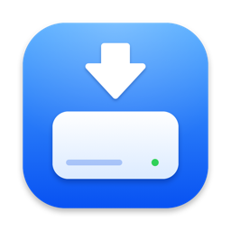
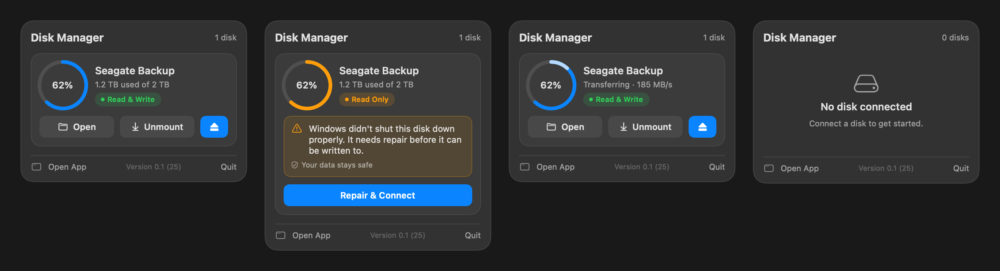
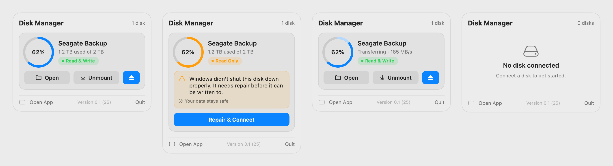

<p align="center"></p>

# NTFS for Mac

[](https://github.com/muhshahabipour/ntfs-mac/releases/latest)
[](LICENSE)


A small, native macOS menu bar app that lets you **read and write NTFS disks** — built for people who move drives between a Mac and Windows and want something calm, fast and reliable (the app talks to the stable `ntfs-3g` driver instead of a bundled kernel driver).

خواندن و نوشتن روی دیسک‌های NTFS در مک، از نوار منو.

<p align="center">
  <br>
  
</p>

*Screenshots are rendered with sample data (`NTFS --render-demo <dir>`).*

**[Project page](https://muhshahabipour.github.io/ntfs-mac/)** · **[Download](https://github.com/muhshahabipour/ntfs-mac/releases/latest)**

> Personal project. Not notarized, no warranty — keep backups of important disks.

- **Menu bar cards** for every connected NTFS disk: Read & Write status, capacity ring, live transfer speed, Open / Unmount / Eject.
- **Safe by default.** Disks that Windows left hibernated (Fast Startup) or unclean stay read-only, with a clear explanation. Only a plainly *dirty* disk offers **Repair & Connect**.
- **Mount / Unmount / Eject** are separate. A disk that was unmounted (even from Finder) shows as *Not mounted* with a **Mount** button.
- **Erase** (quick NTFS format) lives in the main window, behind a typed confirmation, and refuses internal disks and non-NTFS partitions.
- **English and Persian** UI (English is the default), light / dark / auto.
- Notifications when a transfer finishes or a disk needs attention, launch at login, and a first-run setup guide.


## Requirements

| | |
|---|---|
| macOS | 15 or later (developed on macOS 27, Apple silicon) |
| [macFUSE](https://macfuse.github.io) | 5.x, with its **File System Extension** enabled (System Settings → General → Login Items & Extensions → File System Extensions) |
| `ntfs-3g` | from the `gromgit/fuse` Homebrew tap (`ntfs-3g-mac`) |
| Apple Development signing | needed to build the privileged helper yourself (see below) |

## Install (DMG)

1. Open `NTFS-<version>.dmg` and drag **NTFS.app** into **Applications**.
2. Run **“1 - Install prerequisites.command”** (needs [Homebrew](https://brew.sh)), then enable the macFUSE extension and restart if macOS asks.
3. Run **“2 - Allow the app.command”** (removes the download quarantine flag; the app is not notarized).
4. Open **NTFS**. Follow the **Get started** card: enable the helper service, and turn on **NTFS** under Privacy & Security → Full Disk Access.

## Using disks with Windows

macOS can only write safely when Windows shut the disk down cleanly. In Windows: **turn off Fast Startup** (Power Options → *Choose what the power buttons do*) and use **Shut down** (not Restart / Hibernate) before unplugging.

## How it works

```
SwiftUI app (menu bar + main window)
   │  XPC (code-signing requirement on both ends)
   ▼
NTFSHelper — root daemon registered with SMAppService
   │  probe (ntfs-3g.probe) → mount (ntfs-3g over macFUSE FSKit) → unmount / repair (ntfsfix) / erase (mkntfs)
   ▼
NTFSCore — pure Swift: health classification, mount engine, disk watcher (DiskArbitration), throughput (IOKit)
```

- Requests are validated (`/dev/diskN[sM]` only), commands are run with argument arrays — never through a shell.
- A second `ntfs-3g` is never started on a device one of ours already serves.
- `NTFSCore` has no UI dependency and is covered by Swift Testing (`swift test`, 78 tests).

## Build from source

```bash
swift build                    # compile
swift test                     # unit tests
bash scripts/build-app.sh      # signed build/NTFS.app (auto-detects an "Apple Development" identity)
bash scripts/make-dmg.sh       # dist/NTFS-<version>.dmg
```

The app must live in `/Applications` for the helper to register. After updating the app, restart the helper:

```bash
/Applications/NTFS.app/Contents/MacOS/NTFS --reinstall-helper
```

The helper's code-signing requirement is pinned to a Team ID in `Sources/NTFSShared/NTFSShared.swift` — change it to yours.

Other scripts: `scripts/make-test-image.sh` (throwaway NTFS image for tests — never run `mkntfs` on a real drive), `scripts/bench-mount.sh` (mount-option benchmark).

## Performance notes

Measured on a USB 3 flash drive (raw read ≈ 150 MB/s): about 65 MB/s read and 12–15 MB/s write through the FUSE path. `big_writes`, `noatime` and `iosize` made no meaningful difference, so the defaults are kept. A faster disk (SSD) is the real fix.

## Troubleshooting

| Symptom | Cause / fix |
|---|---|
| Disk stays *Read Only*, “macOS is blocking access” | Turn on **NTFS** (the app, not only the helper) in Full Disk Access, then replug |
| Mount starts then silently disappears | macFUSE extension is off — enable it in File System Extensions |
| “Windows is hibernated” | Shut Windows down fully (Shift + Shut down) and replug |
| Helper “not enabled” / “unreachable” | Run `--reinstall-helper` (once), approve it in Login Items if asked |
| Gatekeeper blocks the app | Run “2 - Allow the app.command” |

Probe results are logged under the `com.local.ntfs` subsystem (`log show --predicate 'subsystem == "com.local.ntfs"' --info`).

## Documentation

- `docs/superpowers/specs/` — design spec, `docs/superpowers/plans/` — implementation plan
- `docs/spike-notes.md` — what the initial macFUSE / ntfs-3g spike found
- `docs/design/` — UI reference images

## Credits and licenses

Built on [macFUSE](https://macfuse.github.io) and [ntfs-3g](https://github.com/tuxera/ntfs-3g) (GPL / LGPL). This app only invokes them; it does not bundle them.

The app itself is released under the [MIT License](LICENSE).

---

## فارسی (خلاصه)

برنامه‌ای بومی برای نوار منوی macOS برای **خواندن و نوشتن روی دیسک‌های NTFS**، مناسب کسانی که دیسک را بین مک و ویندوز جابه‌جا می‌کنند. کارت هر دیسک وضعیت، ظرفیت و سرعت را نشان می‌دهد؛ اتصال، قطع اتصال، جدا کردن امن و پاک‌سازی (فرمت سریع NTFS) جداگانه‌اند؛ دیسکی که ویندوز درست خاموش نکرده فقط‌خواندنی می‌ماند و توضیح می‌دهد چرا. رابط فارسی و انگلیسی (پیش‌فرض انگلیسی)، حالت روشن/تیره، اعلان و اجرا هنگام ورود.

**نصب:** فایل DMG را باز کنید ← برنامه را به Applications بکشید ← «1 - Install prerequisites» ← «2 - Allow the app» ← برنامه را باز کنید و کارت «Get started» را دنبال کنید. **نکتهٔ ویندوز:** Fast Startup را خاموش کنید و همیشه Shut down بزنید.
